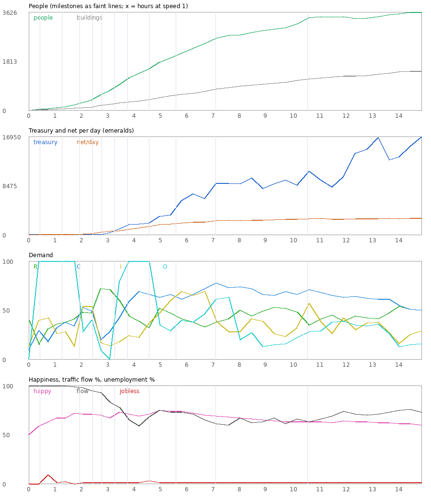

# Townstead: Bringing Cities: Skylines to Minecraft

*Working title was "Blocky Skylines". The mod is **Townstead** (mod id `townstead`),
tagline "From hamlet to metropolis." The repository keeps its old name.*

This document turns the research in [`../research/cities-skylines.md`](../research/cities-skylines.md)
into a Minecraft design. It covers what to keep, what has to change, how each system maps onto
Minecraft's engine, and a phased plan. Technical notes assume NeoForge 26.3 and the
`minecraft-modding` skill in this repo. Settled decisions are in §9, and the survival
supply design is in §10.

---

## 1. The pitch

> **Plan from above, live on the ground.**
> Lay out roads, paint zones and place services from a bird's-eye **Planner view**, and watch
> your city build itself block by block. Then drop down and **walk the streets you designed**,
> among the citizens who live there.

In Cities: Skylines you never inhabit your city. First-person views (mods, CS2 photo mode)
are spectator cameras; you can't act as a person in it. Minecraft is built around inhabiting a world. That's the opening:

1. **Two modes**: the *Mayor* (Planner view, RTS camera, tool palette, info views) and the
   *Citizen* (normal first-person Minecraft inside the city).
2. **Multiplayer cities** (CS never had multiplayer): co-mayors, neighboring cities trading on a
   server, players living in each other's towns.
3. **Minecraft-flavored progression**: monuments that need Minecraft feats (an End Gateway
   Plaza after the dragon falls), districts that harvest real resources, and disasters drawn
   from Minecraft (lightning fires, floods, Pillager raids).

### Competitive landscape (why this isn't already done)

| Mod | What it is | Gap Blocky Skylines fills |
|---|---|---|
| **MineColonies** (NeoForge 1.21.1, active) | Colony sim: you build huts from schematics, citizens with jobs gather and craft | It's a *colony/automation* game: you place every building and feed resources. There's no zoning, demand, land value, traffic or top-down planning |
| **Modern City with Citizens** (Fabric 26.1.2) | Generates cities with citizens commuting between homes and shops | World generation, not player city *management* |
| Road/decor mods (CityUtils, Fureniku's Roads, city modpacks) | Road blocks, signs, traffic-light props | Decoration only, with no simulation |

Nobody has built the **zone → demand → growth → services → level-up** loop with a planner
camera in Minecraft. That loop is the identity of Cities: Skylines, and it's the core of this mod.

---

## 2. Hard constraints of Minecraft (design around these)

| Constraint | Consequence | Design answer |
|---|---|---|
| **Scale**: 1 block = 1 m. CS's zone cell is 8 m | A CS zone cell is exactly **8×8 blocks**, so a chunk is 2×2 cells. Real-scale CS cities (km wide) are impossible | Keep the 8-block cell (true 1:1 with CS), but build **towns**, not megacities: tiles of **64×64 blocks** (4×4 chunks = 8×8 cells), starting with 3×3 tiles (192 blocks) and growing to around 9×9 (576 blocks) |
| **Render distance** (2–32 chunks; players usually run 8–16) | A top-down view can't show a huge city. Chunks are sent around the **player's** position, not a detached camera | In Planner mode the **player body becomes the camera** (invisible, flying, no-clip, high altitude), so the server streams chunks around it. Recommend a LOD mod (Distant Horizons/Voxy) for big cities and make the mod compatible |
| **Chunks unload** when no player is near | A city can't depend on loaded chunks to "live" | The **simulation is abstract** (SavedData), independent of loaded chunks. Block changes queue and apply when the chunk loads (§6.3) |
| **Entity cost**: hundreds of entities per area hurts TPS. Mobs need loaded chunks | Can't embody every citizen or car (CS1 itself capped embodied citizens at about 65k and vehicles at about 16k) | Population is **data rows**. Embody a **sample**: 20–60 ambient citizen NPCs near players, and **client-side visual traffic** (no server entities) following the road graph (§6.5) |
| **Terrain is rugged and editable** | CS zones flat lots. Minecraft land is hills, caves, trees, water | Lots **auto-grade** (foundations and fill, cut slopes). Roads grade terrain along their path. Provide a terraform brush in the planner. Zoning is invalid on steep or watery cells |
| **Building art volume**: CS ships hundreds of models | Hand-building hundreds of structures is a huge content cost | **Hybrid buildings**: procedural generation from style palettes and rules for most growables, plus hand-made NBT templates for services, unique buildings and monuments. All data-driven so packs can add more (§6.4) |
| **Multiplayer server** | Many players, permissions, griefing | Cities have owners/co-mayors/residents. Planner tools respect claims. Abstract simulation runs once on the server |
| **Survival vs creative** | Where do buildings' blocks come from? | **Decided: survival materials.** Construction consumes items from the Town Storehouse; industry later supplies it (§10). A `freeBuild` world option skips materials |

---

## 3. System-by-system mapping

Difficulty: ★ easy · ★★ moderate · ★★★ hard. Phase refers to the roadmap in §8.

| CS system | Blocky Skylines version | Diff. | Phase |
|---|---|---|---|
| **RTS camera & tool palette** | **Planner view**: a toggle key. The player becomes a flying, invisible camera at altitude; a mouse cursor raycasts into the world; a bottom toolbar screen with categories; WASD pan, scroll zoom, Q/E rotate, with eased motion. Built on the verified camera hook (`Camera#update` mixin), the `ComputeFov` event and custom GUI layers | ★★★ | 0 |
| **City founding & tiles** | Place a **Town Hall** to found a city and claim the center tile. Buy adjacent 64×64 tiles with milestone permits plus money. Tile borders are drawn in planner view | ★★ | 0 |
| **Roads** | Road **graph** (nodes, segments, lanes, type) in SavedData. Straight, curve and freeform tools with snapping and a guideline preview (ghost blocks). Each road type is a **cross-section profile** (asphalt, lines, sidewalks, trees, lamps) rasterized to blocks along the curve. Junctions are auto-generated. Grading through terrain, bridges, tunnels. Upgrade tool | ★★★ | 1 |
| **Zoning grid** | Cells auto-generated 4 deep beside zonable roads (8×8-block cells). Paint/fill/erase brushes. Zones R (low/high), C (low/high), I, O. Shown as colored translucent overlays only in planner view | ★★ | 2 |
| **Demand** | RCIO bars computed from jobs vs workers, consumer demand, goods and education (§5). Simple and legible, with visible reasons | ★★ | 2 |
| **Growables** | When demand > 0 on a valid lot, pick a building (procedural or template) for zone/density/level/footprint/district style. **Animated construction**: scaffolding, then layers of blocks appear over about 30–90 s with dust particles and sounds. Level-ups rebuild in place. Abandonment shows boarded-up windows and cobwebs | ★★★ | 2 |
| **Utilities** | **Utilities follow roads** (CS2 style): power and water networks are the road graph, plus explicit power lines/pipes for gaps. Producers: coal plant, wind turbine (Minecraft height = more wind), solar, water mill/hydro, nuclear (late). Water pump on a river, water tower, sewage outlet that visibly pollutes water downstream | ★★ | 3 |
| **Services** | Ploppable structures (hand-made templates) with **coverage radius** previewed on placement: clinic, hospital, fire station, police, schools, landfill/incinerator, cemetery/crematorium, parks. Capacity limits. Vehicles are visual-only (§6.5) or abstract | ★★ | 3 |
| **Citizens** | Households as data: age stage, education, job, happiness, health. Lifecycle and education pipelines with school capacity. Death and illness. Move-in/out. **Ambient NPCs** (custom citizen entity with GeckoLib or vanilla keyframe animations) sampled from real households: click one to see their home, job and mood | ★★★ | 4 |
| **Happiness, land value, pollution, noise, crime** | Per-cell scalar fields on a coarse grid (one value per 8×8 cell), updated incrementally. Sources stamp radial falloffs. Every field has an **info view** | ★★ | 4 |
| **Leveling** | R 1–5, C/I/O 1–3 with CS-like requirements (education, land value, services). **Progress bar with missing factors** in the building panel | ★★ | 4 |
| **Economy** | Treasury, taxes per zone (−10%..30%), upkeep, budget sliders (50–150%), loans. Income/expense panel and graph. **Keep it legible** (CS2 lesson) | ★★ | 4 |
| **Progression** | Population **milestones** unlock tool categories, tiles and policies. Optionally an **XP + development tree** (CS2-style) for service variants. **Unique buildings** with conditions; **monuments** gated by Minecraft feats | ★★ | 5 |
| **Info views** | Heat-map overlays drawn as colored quads on top of terrain in planner view (custom geometry submission), plus a legend. Status **icons above buildings** (billboards: no power, no water, garbage, sick, abandoned, fire) | ★★ | 3 |
| **Chirper** | **"Chirps"**: a slide-in HUD feed of citizen posts with skins/portraits, prioritized by severity, clickable to fly the camera to the problem | ★ | 5 |
| **Districts & policies** | Paint districts with names shown in the world. Policies as toggles (city-wide and per district) with costs and effects. Specializations (forest, farming, ore, oil) map onto Minecraft biomes and ores | ★★ | 7 |
| **Public transport** | Bus lines (stops on roads, a depot) with client-rendered buses, ridership stats and a traffic reduction effect. Later: minecart metro, which is *very* Minecraft | ★★★ | 6 |
| **Traffic** | Abstract flow model: trips are assigned to the road graph with a capacity-based congestion formula (BPR-style), recalculated periodically. Congestion is shown in a traffic info view and in the density of visual cars. No per-car server agents | ★★★ | 6 |
| **Disasters** | Minecraft-native: lightning fires (fire service), river floods (dams), sinkholes into caves, **Pillager raids** (police/guard towers), creeper storms (comedic, optional) | ★★ | 7 |
| **Production chains** | Industry areas whose extractors harvest *real* resources (logs, crops, ore) into a city warehouse, which can supply survival construction or be exported for income | ★★★ | 7+ |
| **Day/night, weather** | Free from Minecraft. Night lighting via lamps placed in road profiles. Rain raises fire safety, snow needs plowing | ★ | — |
| **Modding** | All buildings, road profiles, zones, policies, milestones and unique-building conditions are **data-driven** (datapack/resource-pack JSON + NBT), so creators can ship packs | ★★ | Throughout |

---

## 4. Signature UX: the Planner view

This is the make-or-break feature. It needs to feel like Cities: Skylines, not like flying in
creative mode.

- **Enter/exit:** press a key (configurable; for example `M`) inside your city. A
  smooth 1 s camera ease up to about 60 blocks above the cursor target, with a fade and the HUD
  swapping to the planner HUD. Exit returns you to where you stood.
- **Camera:** WASD pans parallel to the ground (speed scales with height), scroll zooms
  (altitude 12–160), middle-drag or Q/E rotates, and the pitch tilts with zoom (top-down when high,
  oblique when low), like CS. Implemented by driving the player's position and rotation (server
  authority for chunk streaming), with the `Camera#update` mixin for smoothing and roll.
- **Cursor:** the mouse is free (a screen without pause). A raycast from the camera through the
  cursor finds the world position, snapped to cells and road nodes.
- **Toolbar:** a bottom bar with category tabs (Roads, Zoning, Districts, Utilities, Services,
  Transport, Parks, Unique, Bulldoze), thumbnails, costs and tooltips. Pick a tool, and the
  cursor shows a **ghost preview** (translucent blocks or outline) plus the **coverage radius**
  ring.
- **Top bar:** money, income/hr, population, happiness, demand bars, date/time, speed controls,
  and a milestone progress bar.
- **Info views:** a button row or hotkeys that swap the world coloring to an overlay.
- **Building panel:** click a building to see its name, level and progress (missing
  factors), residents/workers, problems and services coverage.
- **Undo/redo** for planner actions (CS1 lacked it, and players added it via mods).
- **Feel:** eased camera, soft click sounds, placement "thunk" plus dust particles, and a growth
  animation, consistent with the skill's polish rules.

---

## 5. A simulation model sized for Minecraft

Principles: legible over deep, incremental over global, and **tick-budgeted** (simulation work
is spread across ticks and never exceeds about 2 ms/tick for a medium city).

**Time:** 1 in-game day (20 min) = 1 "city week". Monthly budget settlement every 4 days.

**Entities in data (SavedData `CityData`):**
```
City { id, name, owner, coMayors[], treasury, taxRates{R,C,I,O}, budgets{service→%},
       loans[], milestone, unlocks{}, tiles{}, policies{}, districts{}, stats history }
RoadGraph { nodes[], segments[ type, curve, lanes, length, capacity, flow ] }
Lot { id, cells[], zone, density, buildingId?, level, state(empty|constructing|active|abandoned|burned),
      households[], jobs[], needs flags, happinessCache }
Household { members[ age, education, jobId?, health ], wealth, homeLot }
ServiceBuilding { type, pos, capacity, coverageRadius, budget, load }
Fields (per 8×8 cell): landValue, groundPollution, noise, crime, coverage[service]
```

**Update cadence (staggered round-robin):**
- Every second: construction progress, cheap demand update.
- Every ~5 s: a slice of lots re-evaluates needs (power/water/service coverage), happiness,
  level-up and abandonment.
- Every ~30 s: fields recompute incrementally (dirty cells only), job matching, education
  graduation, aging, births and deaths, traffic assignment.
- Monthly: taxes, upkeep and loan payments, milestone checks.

**Demand (legible formulas, tunable in JSON):**
- `R = clamp(openJobs − unemployed − vacantHomes×k)`
- `C = clamp(population × goodsPerCapita − commercialCapacity)`
- `I = clamp(commercialGoodsNeed + exportDemand − industrialCapacity)`
- `O = clamp(highlyEducatedUnemployed − officeJobsOpen)`

Each bar's tooltip **lists its top drivers**. That's how we avoid CS2's opaque-economy problem.

**Leveling:** score = weighted sum of {education, landValue, serviceCoverage, happiness}. When
it holds above the threshold for N days, the building levels up. The building panel shows
each factor's contribution.

**Traffic (abstract):** origin-destination pairs come from homes → jobs/shops, aggregated per
lot pair. They're assigned to shortest paths on the road graph, and travel time is updated with
a BPR curve (`t = t0 × (1 + 0.15 (v/c)^4)`). Iterate a few times (cheap incremental assignment).
Congestion feeds commute satisfaction and service response times, and drives visual car density.

---

## 6. Architecture (NeoForge 26.3)

### 6.1 Side split
- **Server:** all simulation, validation of every planner action (cost, permissions, tile
  ownership, terrain validity), block placement, saving.
- **Client:** planner camera and UI, ghost previews, overlays, visual traffic, ambient
  animation, Chirps.
- **Network:** payloads for planner actions (place road, paint zone, place service, set tax,
  …), city snapshot sync (on join and on change, delta-compressed), field tiles for overlays
  (sent only for info views in use), and notifications.

### 6.2 Persistence
- `CityData` as `SavedData` (codec-based). The road graph and lots are in the same or sibling
  SavedData. Player membership and progress as player attachments.
- Version every schema (a `dataVersion` field) for upgrades.

### 6.3 Block changes without loaded chunks
- A **construction queue** per chunk: jobs are lists of block placements generated from a
  structure (template or procedural). On a chunk-load event, pending jobs apply.
- Visible construction (when a player is near) runs incrementally for the animation. Unseen
  construction completes instantly on load.
- Forced chunk loading is **only** for active, player-watched construction, never for the
  whole city.

### 6.4 Buildings
- **Procedural growables:** a grammar for footprint (1×1 to 4×4 cells), floors by density and
  level, roof types, window rhythm, balconies and shopfronts, using a **style palette** (block sets
  per theme: Village Oak, Desert Sandstone, Modern Concrete, Nether Brick…) chosen per district.
  This gives effectively infinite variety at no art cost per building.
- **Template buildings:** `.nbt` structure templates (built in-game by you or creators) for
  services, unique buildings, monuments and signature growables. The data JSON declares
  footprint, entrance/road side, capacity and coverage.
- **Lot fitting:** foundations, grading and road-facing rotation.
- **Look (decided):** everything must look like it belongs in vanilla Minecraft, using the
  block vocabulary and shapes of **village structures**, even for high-density towers.
  Style palettes follow the five vanilla village biomes (plains oak, desert sandstone, savanna
  acacia, taiga spruce, snowy spruce/stone), picked from the district's biome. Shapes: log
  frames and corner posts, cobblestone/stone-brick bases, plank or terracotta walls, glass
  panes, stair-and-slab roofs, flower boxes, lanterns and bells. Taller buildings are stacked
  villager houses: a stone podium, timber-framed floors with jettied overhangs, stair-roofed
  setbacks and a lantern-lit crown. Commercial takes village workstations as storefronts
  (smithing tables, barrels, lecterns). Industry uses composters, blast furnaces, hay bales and
  mud-brick yards. Levels add height and detail, not a modern look.

### 6.5 Life on the streets
- **Ambient citizens:** a custom `CitizenNpc` entity that is non-persistent (despawns away from
  players) and spawned near players on sidewalks to match local density and time of day. It's
  bound to a real household record, so clicking or talking shows real data and lets you hear
  their complaints. Animated (walk, idle, chat). Capped at about 40 per player.
- **Visual traffic:** cars and buses are **client-side render-only objects** spawned by the
  client from road-segment flow values the server sends. They follow lane splines and yield at
  junctions with simple rules. No server entities and no collisions, so cost scales with view,
  not population.
- **Service vehicles:** the same visual approach, with dispatch decided abstractly.

### 6.6 Rendering
- Overlays and heat maps: `SubmitCustomGeometryEvent` with per-cell translucent quads,
  regenerated only when field tiles change.
- Ghost previews: translucent block-model submission. Coverage rings: line geometry.
- Status icons: billboard quads from a GUI-atlas sprite sheet.
- Planner HUD: GUI layers (`RegisterGuiLayersEvent`) plus a non-pausing planner screen for the
  toolbar and panels.

### 6.7 Data-driven content
```
data/<ns>/blocky_skylines/
  zones/*.json          road_types/*.json      services/*.json
  milestones/*.json     policies/*.json        unique_buildings/*.json
  building_styles/*.json (palettes + grammar parameters)
  structures/*.nbt      (templates)
```
Packs can add themes, services and road types without code, which is the CS Workshop lesson.

---

## 7. Scope guardrails

- **Not a traffic engineering sim.** Keep abstract flow plus visual cars. Lane arrows and
  priority signs are a possible later "TM:PE-lite", not core.
- **Not a real economy.** No CS2-style per-household money ledger. Aggregate, legible formulas.
- **Town scale**, not megacity: a mature city is around 5–20k (simulated) population on about
  500×500 blocks.
- **Performance budget is a feature:** a profiling HUD in dev builds, and strict per-tick budgets.

---

## 8. Roadmap

Each phase ends with something playable and screenshot-verified (headless client recipe in the
skill).

| Phase | Deliverable | "Done" looks like |
|---|---|---|
| **0. Foundation** | Project scaffold, Town Hall block, CityData, tiles, **Planner view** camera + cursor + empty toolbar, undo framework | Found a city, fly the planner camera smoothly, see tile borders |
| **1. Roads** | Road graph, 3 road types (small, medium, large), straight and curve tools, snapping, junction generation, terrain grading, bulldoze | Build a road grid and a curved avenue that look good in blocks |
| **2. Zoning & growth** | Zone grid, paint tools, RCIO demand v1, procedural houses/shops/factories (1–2 styles), construction animation | Zone a block, watch houses rise one by one |
| **3. Utilities & services** | Power and water (road-borne), 6 core services with coverage, status icons, info views (power, water, coverage), building panel | A building shows "no power", you place a plant, the icon clears |
| **4. People & money** | Households, jobs, education, happiness, land value/pollution/noise fields, leveling, taxes/budget/upkeep/loans | A balanced town grows, levels up and pays its bills |
| **5. Progression** | Milestones, unlocks, tile purchase, Chirps feed, first unique buildings | Hit "Worthy Village" and unlock a second tile (districts moved to Phase 7) |
| **6. Living city** | Ambient citizen NPCs, visual traffic, bus lines (coach lines), traffic flow model and info view | Walk your streets among citizens while coaches run routes |
| **7. Depth** | Districts and policies, specializations, disasters (fires), monuments, multiplayer roles (co-mayors), more styles (jungle, swamp) | Megalopolis reached by a synthetic town (§18); a played run moves to Phase 9 |

**MVP / vertical slice = Phases 0–3 plus a minimal Phase 5** ("Little Hamlet" to "Worthy
Village"). That's the smallest thing that *feels* like Cities: Skylines in Minecraft.

### Road to release (Phases 8–12)

Phases 0–7 built every system. These phases make it a game someone else can pick up, play
for weeks and keep their world. Details in §19.

| Phase | Deliverable | "Done" looks like |
|---|---|---|
| **8. Self-sufficient towns** ✓ | Industry produces building materials into the storehouse: lumber yards (logs, planks), farms (hay, wool), a new Quarry specialisation (cobblestone, stone bricks, sandstone), workshops that process raw into finished goods (glass, bricks, lanterns, fences, workstations). Production view and storehouse flow readout; exports for emeralds | A survival town grows from Big Town onward with the player gathering nothing by hand |
| **9. Balance and a real play-through** ✓ (Megalopolis in 10-15 h not yet: Metropolis at 10.6 h, §19) | A scripted "autoplayer" that plays like a person (roads, zoning, services, budgets) from hamlet up; tuning of demand, money, happiness, growth time and building cost from its data; difficulty presets | An unscripted-growth survival run reaches Megalopolis in a target of 10–15 real hours at default speed, never stuck, never broke for long |
| **10. Multiplayer and server** ✓ | Dedicated-server soak with several towns and players, two-player co-mayor session, permission and packet-validation audit, chunk-loading edge cases, performance budget per town, admin commands | Two players on a dedicated server run a shared town and a separate one for an hour with no desync, errors or tick lag |
| **11. Onboarding and feel** ✓ | First-time advisor (step-by-step hints from Town Hall to Worthy Village), in-game guidebook, settings screen, a co-mayor list in the planner, colour-blind safe info views, visible smoke and service vehicles (fire carts, compost carts) | A new player founds a town and reaches Worthy Village without reading the README |
| **12. Release** | Save versioning with migrations, upgrade tests from older saves, crash-free long soak, translation readiness, mod metadata, licence, icon, CI builds, changelog, Modrinth/CurseForge page text and screenshots | A 1.0 jar and page ready for the author to publish; worlds from 0.x load in 1.0 |

---

## 9. Decisions (settled 2026-10-18)

1. **Mode: survival materials.** Construction consumes real items. See §10.
2. **Buildings: hybrid.** Procedural growables plus hand-made templates for services, unique
   buildings and monuments. All are generated by Claude in-repo.
3. **Scale: 8-block zone cells and 64-block tiles.**
4. **Loader: NeoForge 26.3.**
5. **Multiplayer: test single-player first.** The data model still allows several cities and
   co-mayors.
6. **Style: vanilla village look**, even for skyscrapers (§6.4).
7. **Name: Townstead** (mod id `townstead`). Avoid Paradox/Cities: Skylines names, logos and
   art in releases.
8. **Everything is real blocks.** Whatever the planner builds (roads, houses, shops, services,
   parks, utilities, transit) is placed in the world as ordinary Minecraft blocks, so after
   leaving the planner you can walk, mine and build in the city like anywhere else. Planner
   overlays (ghosts, borders, heat maps, icons) are view-only aids and never stand in for the
   build. Simulated values (population, demand, traffic) live in data, but every building they
   describe exists in the world. Building in unloaded chunks waits in the construction queue
   (§6.3) and finishes when the chunk loads, never as an abstract stand-in.

## 10. Survival supply design

The city is built from real items, so the mod plugs into normal Minecraft play instead of
replacing it.

- **Town Storehouse.** A block placed in the city (crafted early, near the Town Hall).
  Players deposit items. Linked **supply crates** (any chest with a crate upgrade) extend
  capacity. The storehouse inventory is the city's material stock, shown in the planner's top
  bar and in a storehouse screen.
- **Treasury in emeralds.** The treasury is a number backed by emeralds: deposit or withdraw
  at the Town Hall. Taxes accrue to it, and upkeep and tile purchases spend it. Emeralds are
  Minecraft's currency (villager trading), so this fits without a new coin.
- **Bill of materials.** Every plan (road segment, growable building, service) produces a
  material list from its block list, with similar blocks grouped (any planks, any logs, any
  stone bricks).
  - **Roads** reserve and consume materials when placed. If stock is short, the tool shows
    exactly what's missing in red and refuses.
  - **Growables** start building when demand exists. Construction pulls from the storehouse
    layer by layer. If something runs out, the site **pauses** with a floating "needs 12 oak
    planks" icon and a Chirp, then resumes when stock arrives.
  - **Services and unique buildings** show their full cost up front and wait for materials
    before breaking ground.
- **Closing the loop.** Early on, the player gathers materials by hand. Later, **industry
  zones and resource districts produce materials into the storehouse** (forestry yields logs,
  quarries yield stone, farms yield crops for food demand). Mid-game the city feeds itself,
  and the player's job shifts from gathering to planning, which mirrors Cities: Skylines'
  industry loop.
- **Deconstruction refunds** a share of materials (bulldozing returns about 50%; recently placed
  plans return 100%).
- **Creative/peaceful option:** a world setting `townstead:freeBuild` skips materials, for
  builders and for testing.

## 11. Phase 1 as built (roads)

- **Graph:** `RoadNetwork` (SavedData per dimension, `data/townstead/roads.dat`): nodes and segments.
  A segment is a quadratic Bezier centreline plus its graded heights (sampled once per block), so
  its blocks can be recomputed without reading the world. The client gets the whole graph for its
  dimension for snapping and previews.
- **Cross-sections:** lane `CCC` (3), street `SCCCS` (5), avenue `SCCCMCCCS` (9). C is dirt path,
  S stone bricks, M grass. Streets get lamp posts every 16 blocks on alternating walks; avenues
  get hedges every 4 and lamps every 16 in the median. Plains palette only for now; biome palettes
  come with growables.
- **Junctions:** a new road that crosses, starts on, or ends on an existing one splits it at that
  point. Where two columns overlap, carriageway beats median beats sidewalk, then the nearer
  centreline. Junctions of three or more roads, or of two at an angle, get a round paved cap so
  corners fill in.
- **Grading:** median ground height across the road width (ignores trunks and posts), smoothed,
  with a 1-in-2 grade limit; ends joining a road are pinned to it. Up to 12 blocks of fill (dirt,
  or cobblestone in water) and 16 of cut. Deeper dips and higher hills wait for bridges and
  tunnels.
- **Supply:** the Town Storehouse holds a virtual stock on the town (not a block inventory), so
  any storehouse of the town reaches it and it works with the storehouse chunk unloaded. Bills are
  per material group (item tags `townstead:materials/*`), and digging returns dirt, cobblestone
  and logs. Bulldozing refunds 100% within 5 minutes of building, 50% after.
- **Undo/redo:** every edit journals the blocks it changed (before/after), its road-graph diff and
  its stock delta. Undo restores all three; blocks changed by hand since are skipped and reported.
  32 entries per town, in memory for the session. Every later planner tool records the same way.
- **Not yet:** road upgrade tool, freeform (multi-bend) roads, bridges and tunnels.

## 12. Phase 2 as built (zoning and growth)

- **Lots:** the fixed 8×8 world cells. A cell is zonable when a road runs along one edge, either
  within 4 blocks outside it (a grass verge, crossed by a path from the door) or through its first
  two rows (the building is set back and kept shallower). Road deeper inside the cell rules it
  out. The road grid snap puts centrelines down the middle of cell rows, so a straight road
  consumes one row and leaves both sides zonable.
- **Demand (legible, per town):** households H (3 people each), shop jobs Jc, workshop jobs Ji,
  workers W = people/2. R = 40 + 3·(Jc+Ji−W), C = 6·(people/6 − Jc), I = 5·(people/5 − Ji) + 10,
  clamped 0–100. Sites under construction count, so the town doesn't overbuild. A zone needs 15 to
  grow; at most 2 sites per town at once; the free lot nearest the Town Hall goes first.
- **Buildings:** procedural from a seed (no stored block lists): cottages 5–6 × 5–6, 1–2 storeys;
  shops 6 wide with a workstation, shop window and striped awning; workshops 6 × 6 with a chimney
  campfire, hay and barrels. Plains-village palette (oak, spruce, birch). One block every 4 ticks,
  each costing one unit of its material group; doors place both halves; scaffolding rises beside
  the walls and comes down at the end. Lots are levelled first (felled logs go to the storehouse).
- **Simulation records:** `LandData` (per dimension) holds zones and buildings (zone, cell,
  frontage, floor height, seed, setback, progress, households/jobs, what a paused site needs).
- **Undo:** zoning strokes and building demolition go through the same history as roads.
- **Added after the first cut:** levels 1–3 with legible factors (Progression), rebuild-in-place
  upgrades that salvage what the new plan drops, abandonment after 10 minutes of trouble (no road,
  unemployment, no customers or workers) with boarded windows and cobwebs and repair on recovery,
  high-density homes and shops (from 30 people) and offices (from 40), five biome palettes,
  deterministic residents and employment (names, ages, trades after the villager professions) in
  a building panel, and offline construction: sites owe steps while unloaded and catch up by
  loading their chunks every 30 s; growth may open sites in unloaded chunks. A `growthSpeed`
  server setting scales build rate and timers.

## 13. Phase 3 as built (utilities and services)

- **Utilities are road-borne** (as in Cities: Skylines 2, which dropped pipes and pylons): road
  nodes are joined with union-find into networks, and a building belongs to the network of the
  road it faces. Each network pools the capacity of its active plants and wells: windmill 40
  power, watermill 80 (needs water beside the lot), well 30 water, water tower 90. Buildings are
  served oldest first (abandoned ones last); the rest go without. Demand per building: homes one
  per household, shops and offices one per two jobs, workshops one per job, services one.
- **Services cover a radius** from their lot: clinic 48, fire station 56, guard house 56,
  school 64, compost yard 80, park 32 blocks. Each is a real procedural building (palette by
  biome) with a few jobs that draw on the town's workers, so services also count as jobs for
  demand.
- **Levels now ask for them:** level 2 needs power and water; level 3 adds per-zone services
  (homes: clinic, school, park; shops: guard house, compost yard; workshops: fire station,
  compost yard; offices: guard house, school, clinic). A level-2+ building that loses power or
  water is in trouble and is eventually abandoned.
- **One pure function** (`Utilities.compute`) feeds the server's level and trouble checks and
  the client's status icons, info views and building panel, so what the player sees is what the
  simulation decided.
- **Planner:** the Utilities, Services and Parks tools place a chosen building on a road-facing
  lot (ghost, coverage ring, bill of materials, reason when it can't go there); the Info tool
  colours buildings by power, water, each service's coverage or level. Status icons over roofs
  are projected through the camera's near plane. Placing goes through undo like everything else;
  zoning strokes skip service lots.
- **Deferred to Phase 4:** upkeep and budgets for services, service capacity (patients,
  pupils), garbage and fire as events, and land value effects of parks.

## 14. Buildings, revised (after playtest feedback)

Feedback: buildings were all one size and grew upward; the town looked stacked and basic. Changes:

- **Lots of 1–4 cells.** A building's lot is 1×1, 2×1 (along the road), 1×2 (deep) or 2×2 cells.
  Each zone draws a lot shape by weight (homes mostly 1×1 and 2×1; high density, markets,
  industry and offices mostly 2×1 and 2×2) and falls back to smaller lots. Services have fixed
  footprints (school 2×2; clinic, fire station, compost yard, park, watermill 2×1). Cells right
  behind a road-facing cell are zonable for deep lots.
- **Composed architecture** (`BuildingGenerator`): buildings are masses (main block, wings, bays,
  lean-tos) with timber framing on a stone plinth, symmetric windows (tall on the ground floor,
  flanking doors), open-trapdoor shutters, jettied upper floors on brackets, gable roofs with
  eaves and attic windows, hipped roofs, dormers, brick chimneys with smoke, porches, door hoods,
  and lots dressed with hedges, flowers, paths, fences and gates, trees, vegetable plots, lamps
  and benches. Plains and taiga towns mix roof colours (dark oak, spruce, brick).
- **Build order and shapes.** Steps go ground work, frame, roof, fittings, garden, so lanterns and
  torches always have something to hang on; each placed block takes its shape from its
  neighbours (fences and panes join up, stair corners turn).
- **Levels spread out:** wings, porches, lean-tos, dormers and gardens come with levels, not just
  storeys.
- A **Bricks** material joins the storehouse groups (chimneys, fire stations, brick roofs).

## 15. Phase 4 as built (people and money)

- **One model of the town** (`sim.TownModel`) is built from the buildings, roads and budget: power
  and water (with department budgets scaling plant output), service reach (budget scales radius:
  80% at a 50% budget, 120% at 150%), the land fields, who is schooled, who works where, demand
  and happiness. The server uses it to decide (growth, levels, trouble, taxes); the client builds
  the same one to explain (panel, info views, budget, Town Hall).
- **Money** in hundredths of an emerald. Settlement every 600 ticks applies a fortieth of the
  daily figures (scaled by `growthSpeed`) and records a ledger entry. Taxes: households ×
  4 emeralds × level factor (1, 1.5, 2.25) × land-value factor (0.8 + value/250), filled jobs ×
  5/4/7 emeralds (shops/workshops/offices) × level factor, times the rate. Upkeep per service at
  its department budget; roads 1/2/4 hundredths per block of lane/street/avenue a day; loans
  repaid daily. Debt halves service strength. The Town Hall holds emeralds; withdrawals keep a
  25-emerald founding reserve and anything owed on loans, so loans can't be cashed out.
- **Education** per resident (0–3, from the seed: 30/45/20/5%); a school in reach adds one.
  Employment fills skilled jobs first (offices, clinic, school need level 2). Office demand
  follows well-educated adults. Taxes push all demand three points per percent from 9%.
- **Happiness** (0–100) = 50 + factors: power/water (+5, or −5/−15 missing at level 1/2+),
  services in reach (+5, park +8), land value ((v−50)/5), pollution (−p/3) and noise (−n/5) at
  homes and offices, taxes ((9−rate)×2), unemployment over 10%, short staff, customers, debt.
- **Fields** per cell from point sources with linear falloff: pollution (workshops 30+, compost
  yard 25), noise (shops 12–20, workshops 15, fire station 12, roads by type, loudest stretch),
  land value (base 30, Town Hall +12, parks +25, services +6, shops +4, minus 0.6·pollution and
  0.4·noise).
- **Levels** now also need happiness (50 / 65), land value 50 at level 3 for homes and shops, and
  20 well-educated adults for level-3 offices. Trouble adds "unhappy" (with its worst factor) and
  offices short of educated staff.
- **UI:** budget panel (L / treasury click), treasury with daily net and town happiness in the
  top bar, info views for happiness, land value, pollution, noise and education (heat maps for
  the fields), building panel sections for happiness factors, the lot's fields and taxes, and
  each resident's education; Town Hall treasury screen.
- **Deferred:** ageing, births and deaths, crime, garbage and fire as events, service capacity.


## 16. Phase 5 as built (progression)

- **Milestones** (`progress.Milestone`): Little Hamlet (start), Worthy Village (40 people),
  Tiny Town (100), Boom Town (200), Busy Town (350), Big Town (550). Each lists the road types,
  zones and services it unlocks, its emerald reward and its extra land allowance (+1, +2, +3, +4,
  +6 tiles on top of the starting 3×3). The economy settlement checks population against the next
  milestone (`progress.Milestones`); reaching it pays the reward, shows a title and subtitle with
  the challenge-complete sound, notifies the mayor and posts a chirp. A town never loses a
  milestone. The synced setting `unlockAll` skips the gates.
- **Unlocks are enforced on the server** (road builds, zone painting, service placement refuse
  locked things with "X unlocks at Y") and **explained on the client**: locked sub-tools are
  greyed with a cross and an "Unlocks at Worthy Village (40 people)" tooltip, and picking one
  flashes the reason. The top bar shows progress to the next milestone; **U** opens the milestone
  panel (each title, its people, reward and land, icons of what it unlocks, a progress bar).
  Districts, which the roadmap first tied to Worthy Village, moved to Phase 7 with policies.
- **Land** (`city.TownActions.buyTile`): the Land tool outlines buyable tiles in gold (dim gold
  when the treasury or the milestone allowance falls short, red when too close to another town)
  and fills the hovered one. A tile must border the town's land and keep the usual gap from other
  towns. Price: 40 emeralds × (tiles owned − 8), so the tenth tile costs 40 and each one after
  costs 40 more. Bought land is claimed at once and is zonable like the rest.
- **Chirps** (`progress.Chirps`): short posts signed by a real resident (picked from the town's
  households), two or three text variants per event: moved in, opened, levelled up, trouble
  starting, abandoned, repaired, new service, landmark, milestone, land bought, broke, solvent.
  Routine news is limited to one per 20 seconds per town; milestones, landmarks, abandonment,
  land and debt always get through. The planner shows the latest three for 15 seconds in the top
  right with a chime. With Inspect or Info, clicking one flies the camera to the place it's about;
  with an editing tool they let clicks through and fade under the cursor (the first playtest had
  a chirp swallow the end click of a road).
- **Landmarks**, the first unique buildings: Founders' Fountain (2×1 lots, radius 48, Worthy
  Village), Clock Tower (1×1, radius 80, Boom Town) and Chapel (2×2, radius 64, Busy Town). One
  per town, placed with the Landmarks tool, built block by block like services, staffed by a
  keeper and a gardener, upkeep from the parks department. Each adds land value (+22 at the
  centre) and +6 happiness to every building in reach.

## 17. Phase 6 as built (living city)

- **Routing** (`road.RoadRouter`): Dijkstra over the town's junction graph from a point on one
  segment to a point on another, leaving and entering segments part-way. Shared by traffic, coach
  lines and the vehicles drawn on the streets. Speeds: lane 1.0, street 1.3, avenue 1.8.
- **Traffic** (`sim.Traffic`, part of the shared `TownModel`): trips are commutes (each filled job,
  home to workplace and back: 2 trips), errands (a round trip per two households to the nearest
  shop: 1 trip per household) and deliveries (0.6 per workshop job to the nearest shop). Identical trips merge; each is assigned a quarter at a
  time over four rounds, every round routing on travel times that include the previous rounds'
  congestion (BPR: t = t0 × (1 + 0.15 (v/c)^4)). Capacities per day: lane 30, street 80, avenue
  200 (tuned after the first playtest, where a 50-person town never passed a third of any road's
  capacity; now a lane carrying a town's cross traffic jams at around 70 people). Outputs: flow and v/c per segment, each home's commute delay, and the town's *traffic flow*
  (free-flow time over actual time, as in Cities: Skylines).
- **Carts crawl in jams:** a cart's speed is divided by the same BPR factor as the road it's on.
- **Effects:** homes whose commutes take over 25% longer lose up to 12 happiness ("Stuck in
  traffic"); road noise now scales with load (40% of the old figure on an empty road, up to 160%
  jammed); the traffic info view colours roads by v/c and reads out a hovered road's trips.
- **Coach lines** (`transit.CoachLine`, `transit.CoachLines`): loops of 2–24 stops drawn with the
  Transport tool, up to 8 per town, 0.5 emerald a stop. Stops are real blocks: a spruce post with a
  standing banner in the line colour and a spruce-stair bench, removed with the line. Stops keep
  their post position, so a road split by a new junction or rebuilt is found again by position. When
  a road is bulldozed (or its building undone), stops that went with it come down and leave their
  line; a line left with fewer than two stops is removed.
  The **Coach House** (2×1 lot, a timber stable with two coach doors and a paddock; unlocked at
  Worthy Village; new Transport department) is needed for coaches to run. A line runs one coach
  per 90 blocks of route at a 100% budget. A commuter rides when home and work are each within 40
  blocks of different stops of a running line (60% of them, a stable share by name, scaled by the
  budget); riders add no car trips, coaches add four trips each along the route, riders pay 4
  hundredths a day, coaches cost 1.2 emeralds a day.
- **Street life** (`client.StreetLife`): client-only puppets (vanilla horse/donkey/mule, minecart
  and villager entities that are never added to the world, given negative ids and drawn through
  the entity render dispatcher from `ExtractLevelRenderStateEvent` / `SubmitCustomGeometryEvent`).
  Carts spawn on roads within 112 blocks of the camera, picked by flow, about one per six trips
  a day per 64 blocks, and wander the graph turning by flow; they keep right (0.8 blocks off the
  centreline, 2 on avenues). Coaches (two horses abreast, a minecart with a carpet canopy in the
  line colour, two villager passengers) run evenly spaced round each line and dwell 2.5 s at every
  stop. Drawing failures are caught and logged once, never crash the game.
- **Citizens** (`life.CitizenNpc`, `life.Citizens`): a non-saved `AgeableMob` with the villager
  model, dressed by town style (villager type) and trade (profession; plain clothes for children
  and the jobless). Around each player in a town, up to a quarter of the population (max 24) are
  out by day and a quarter of that at night, spawned 12+ blocks away on sidewalks (lane verges),
  each a real person from a home within 48 blocks, never two copies of one person. They stroll
  between street points, look at players, and on right-click say their name and age, home, job
  (or school, retirement, job hunting) and mood with their home's biggest complaint or joy.
- **Deferred:** pedestrian trips and walking in the model, service vehicles, minecart metro,
  per-lane junction behaviour.

## 18. Phase 7 as built (depth)

- **Districts** (`district.District`, `district.DistrictEditor`): up to 16 named, coloured regions
  painted cell by cell with the Districts tool (new / paint / erase / select). A cell belongs to
  at most one district; painting over another district moves the cell. Each gets a village-style name
  (Millbrook, Ashcroft, Kingsgate...). Selecting a district opens its panel: cells, people,
  specialisation and its own policies; the district can be deleted there.
- **Policies** (`district.Policy`): set for the whole town (**P**) or per district (the district's
  setting adds to the town's). Each has a plain effect wired into the shared model, and some a
  daily cost (a new *Policies* line in the budget):
  Clean Hearths (workshop pollution ×0.5, fire risk ×0.7; 3 hundredths per workshop job),
  Quiet Nights (shop and workshop noise ×0.6, shop tax ×0.9), Market Days (+15 commercial demand,
  shops never short of customers, louder), Lantern Streets (land value +6; half a hundredth per
  block of road), Garden Town (homes +3 happiness, land value +3; 1 hundredth per household),
  Old Town (no growth past level 2, land value +8, homes +3), Craftsmen's Relief (workshop tax ×0.5,
  +15 industrial demand), Evening Classes (every home counts as schooled; 2 hundredths per
  adult), Free Coaches (town-wide only: no fares, coach share ×1.4).
- **Specialisations** (`district.Specialization`): a district can make its industry *Farming*
  (barns, fenced crop fields with water rows, a scarecrow, a granary at level 2; pollution ×0.15)
  or *Forestry* (an open saw shed, log stacks, sapling rows on podzol, a charcoal kiln at level 2;
  pollution ×0.6), and its shops *Leisure* (taverns with lantern-lit beer gardens; louder, tax
  ×1.3). A lot takes its district's specialisation when its site opens (farms and lumber yards
  prefer big lots) and keeps it. Workers get matching trades (farmer, shepherd, woodcutter, sawyer,
  innkeeper, barkeep) and the citizens on the street dress for them.
- **Fires** (`disaster.Fires`): checked at every review. A building outside any fire station's
  reach catches fire about once per 1.2 million ticks at growth speed 1 (about one fire every 20
  minutes in an unprotected town of 50 buildings); workshops ×2, shops ×1.2, forestry ×1.5,
  leisure ×1.4, level 3 ×1.25, Clean Hearths ×0.7, inside a fire station's reach ×0.25. Fires
  start only once fire stations are unlocked (Tiny Town), and the server setting `fires` turns them
  off. A burning building smokes (seen from the planner), flames lick from its walls, the bell
  rings, and residents chirp. Inside a station's reach the brigade puts it out after 900 ticks
  (less with a bigger fire budget); outside it, the building burns down after 2400 ticks and the
  fire may jump to the nearest neighbour within 13 blocks. A burned building is a charred shell
  (roof and timber gone, posts turned to basalt, lower walls blackened, embers smouldering), stands
  abandoned and is rebuilt like any abandoned building once its area is healthy, paying for the
  new blocks from the storehouse. Drawn with particles, never real fire blocks, so nothing
  spreads beyond the town's own buildings. `/townstead ignite` (operators) lights the nearest one.
- **City milestones to Megalopolis:** Small City (800 people, 600 emeralds, +6 tiles, unlocks the
  Great Library), Big City (1100, 800, +6), Grand City (1500, 1000, +8, the Cathedral), Capital
  City (2000, 1300, +8), Colossal City (2600, 1600, +10), Metropolis (3300, 2000, +10, the Castle
  Keep), Megalopolis (4000, 3000, +12). The milestone panel scrolls to keep the current ones in
  view.
- **Monuments** (`ServiceType.monument()`): unique landmarks with town-wide effects, land value
  +30 and happiness +10 in reach.
  - *Great Library* (2×2, reach 140, Education): a stone hall with a columned portico, galleries
    of books round an open reading room under a lantern cupola; every home in reach counts as
    schooled.
  - *Cathedral* (3×3, reach 180, Parks): a cruciform nave and transept with a slate roof, two west
    towers with belfries and spires, a crossing spire, a rose window, stained-glass lancets and
    flying buttresses; pilgrims add +12 commercial demand.
  - *Castle Keep* (3×3, reach 200, Police): curtain walls with battlements, four corner towers, a
    gatehouse with a portcullis and a four-storey keep flying the town's banner; its garrison
    counts as guard house and fire station coverage everywhere in reach.
- **Co-mayors** (multiplayer roles): `/townstead comayor add <player>` (mayor only), `remove
  <name>`, and `/townstead comayor` to list. Co-mayors open the planner on the town and can do
  everything there (roads, zoning, services, districts, policies, taxes and budgets, lines), use
  the storehouse, and get the town's news, chirps and milestone titles. Loans, withdrawing from
  the treasury, renaming and naming co-mayors stay with the mayor.
- **More styles:** *jungle* (jungle and bamboo timber, bamboo-mosaic or jungle roofs, mossy
  stone, bamboo fences, jungle trees, jungle villagers) and *swamp* (mangrove timber, mud-brick
  footings and chimneys, dark and mangrove roofs, orchids, swamp villagers), chosen from the
  biome like the others.
- **Scale:** a synthetic Megalopolis (4000 people, 680 buildings, a 20×20 junction grid of 760
  segments) used to take 1.5 s to model. Now trips are routed one shortest-path tree per origin
  per round over array-indexed junctions with per-segment time arrays, the nearest road to a
  building is looked up in a 16-block spatial index, and each town's road columns are worked out
  once per change to the network: 0.15 s with identical results. The server keeps a town's model
  while its buildings, roads and plans are unchanged (up to 100 ticks) and the planner no longer
  recomputes it for every block laid, so a big town costs a model every few seconds at most.
- **Deferred:** other disasters (floods, storms), district-level budgets and taxes, per-district
  info views, more monuments, a co-mayor list in the planner.


## 19. Road to release: the plan for Phases 8–12

### Phase 8: self-sufficient towns (closing the loop of §10)

- **Production.** Every working industrial building produces into the town's storehouse once a
  day (scaled by growth speed), in proportion to the jobs it has filled and its level:
  lumber yards make logs (and planks once a sawmill stands at level 2), farms make hay and wool,
  quarries make cobblestone and stone bricks (sandstone in the desert, terracotta in the
  savanna). Ordinary workshops are *processors*: each takes raw materials from the storehouse
  and turns them into finished ones (logs to planks and fences, cobblestone to stone bricks,
  sand-free glass from "glassworks" workshops, clay-free bricks, lanterns and workstations), so
  a town needs both kinds.
- **New specialisation: Quarry** (industry), with its own generator (an open pit with terraces,
  a crane, rubble heaps, a stone-cutting shed) and pollution and noise like heavy industry.
- **Storehouse limits.** The storehouse holds a capped amount per material (more storehouses,
  more room), so overproduction is visible and wasteful, and the planner shows days of supply.
- **Exports and imports.** A surplus over the cap can be sold for emeralds each day (a new
  Exports line in the budget); a shortage can be bought at a premium at the Town Hall, so a
  missing material never stalls a town for good.
- **UI.** An industry info view (what each building makes and uses), a production panel in the
  budget (made, used and net per material per day), and construction sites that say which
  producer would supply what they're waiting for.
- **Model.** Production lives in the shared `TownModel` like everything else, so the client
  shows the same numbers the server applies.

#### Phase 8 as built

- `industry/Industry.java` holds the trades and recipes. Each working industrial building runs
  4 batches per filled job a day (×1.5 at level 2, ×2 at level 3, half without power or water).
  Per batch:

  | Trade | Who | Takes | Makes |
  |---|---|---|---|
  | Farm | Farming districts | | 2 hay, 1 wool |
  | Lumber yard | Forestry districts | | 3 logs, 1 leaves (+2 planks from level 2) |
  | Quarry | Quarry districts | | 3 cobblestone (sandstone in the desert), 1 dirt (+1 terracotta in the savanna, +1 stone bricks from level 2) |
  | Carpenter | Workshops | 1 log | 3 planks, 1 fence |
  | Mason | Workshops | 2 cobblestone | 2 stone bricks |
  | Glassworks | Workshops | 1 log (fuel) | 3 glass |
  | Brickworks | Workshops | 2 dirt, 1 log | 3 bricks (+1 terracotta in desert and savanna) |
  | Smithy | Workshops | 1 cobblestone, 1 log | 1 lantern |
  | Cooper | Workshops | 2 planks | 1 workstation |

  An ordinary workshop's trade comes from its seed. Raw trades run first, then processors in
  the order above, each running only the batches the stock (plus what was made earlier that
  day) can feed.
- **Room:** 512 per material, plus 1024 per Town Storehouse block. Production beyond that is
  sold at the material's price (1 to 20 hundredths of an emerald a unit); buying in costs three
  times as much and never takes the treasury below zero. Players' own deposits aren't capped.
- **Applied** at each settlement (a fortieth of a day, scaled by growth speed). Fractions carry
  over per town, so slow trades still deliver. The model's day (`TownModel.industry()`) uses the
  stock synced with the town, so the planner shows what the server will do.
- **Quarry:** a stone-cutting shed by the road and a terraced pit (up to three blocks deep) dug
  when construction starts. Plans gained a `dig` list for this. The stone dug out goes to the
  storehouse. Quarries pollute 30% more than other industry and make twice the noise, reaching
  further.
- **UI:** the budget's second page (*Production*), the *Exports* line, the *Industry* info view,
  the building panel's trade and daily flow, supplier hints on waiting sites, two advisor tips,
  and a buy row at the Town Hall.

### Phase 9: balance and a real play-through

- **Autoplayer** (test harness, not shipped): drives the real planner payloads like a person
  would. It lays a grid, zones by demand, places utilities and services where coverage is
  missing, buys land when it runs out of lots, sets budgets and specialisations, and keeps
  the books positive.
- **Tuning from data.** It logs population, money, happiness, demand, traffic and material
  flow every in-game day; tuning targets are curves, not single numbers (each milestone in
  a set time band, the treasury rarely negative, no zone demand pinned at 0 or 100 for long).
- **Difficulty presets**: Relaxed / Normal / Hard (taxes, costs, demand, fire rate, growth
  time), as one server setting.

#### Phase 9 as built

**The autoplayer** (`tools/autoplayer`, not shipped) plays a town from founding in survival at
growth speed 20 (a time-lapse: three real minutes per speed-1 hour), through the same calls the
planner's payloads make, and logs a CSV row per in-game day. It brings a starter kit and gathers
up to 1,500 blocks an hour by hand until Big Town, buys in the rest, and otherwise plays like a
careful mayor (see its README). Twenty-odd runs drove the changes below; each fixed something a
run showed.

**Growth speed is a true time-lapse.** New sites and building reviews used fixed 40- and
100-tick timers, so a sped-up town built faster but started sites at the normal rate. Both now
scale with the speed (as construction, money and production already did).

**The early game.**
- Services and utilities the mayor places no longer take growth's two building places: a
  windmill and a well waiting for stone used to stop the first homes.
- The founding purse is 50 emeralds (was 25).
- Unemployment costs a home at most 20 happiness (was up to 45), so a hamlet short of jobs
  isn't abandoned before its first workshops open.
- A town in debt runs at three-quarter strength (was half): half strength halved water and
  power, which made buildings lose them, which made the town poorer.
- More land early: a new town may buy two tiles straight away, and the early milestones give
  2, 2, 3, 4 and 5 tiles (were 0, 1, 2, 3 and 4), so rough ground can't lock a town out of the
  milestone that brings more land.

**Materials.** A level-1 cottage costs about 218 units for one household; a young town makes and
gathers about 5,000 units an hour, so growth was gathering-bound.
- Builders get two blocks out of each unit (every other step is free; refunds and salvage
  match).
- Industry runs 10 batches per worker a day (was 4), and lumber yards saw planks from level 1.
- Sidewalks cost cobblestone (was stone bricks, which a young town rarely has: streets kept
  stalling on it).
- A new ordinary workshop takes up the trade the town is shortest of (sites waiting, low stock),
  instead of a random one, so bricks, glass and lanterns get made when they're needed.

**Demand.** It planned 1.5 workers a household (Residents makes two adults) and jobs for only
three quarters of them, so towns sat at 30-45% unemployment and stalled between milestones. Now
two workers a household, shops planned for 40% of them and workshops 45%, offices for 60% of the
well educated; and every bar is relative to the town's size (homes follow jobs per worker, the
others how far their jobs fall short of their share), so it means the same in a hamlet as in a
city and no longer pins at 0 or 100.

**Money.** Taxable values up 20% (households 480 a day, shop jobs 600, workshop jobs 480, office
jobs 840); the town's own exports and imports (Phase 8) do the rest.

**Bigger towns build more at once:** one more building site for every 40 households (up to 8),
one more upgrade for every 60 (up to 4).

**Traffic.** Roads carry 2.5 times as much before they slow (lanes 75, streets 200, avenues 500
trips a day): a sensible grid jammed at 400 people.

**Fires** start a quarter as often (a building outside a brigade's reach about once in 70
speed-1 hours).

**Difficulty presets** (server setting `difficulty`):

| | Relaxed | Normal | Hard |
|---|---|---|---|
| Taxes | ×1.25 | ×1 | ×0.85 |
| Upkeep, land price | ×0.8 | ×1 | ×1.2 |
| Imports cost (× selling price) | 2 | 3 | 4 |
| Demand | +10 | 0 | −10 |
| Fires | ×0.5 | ×1 | ×1.5 |
| Building and levelling pace | ×1.3 | ×1 | ×0.8 |

**Utilities** scale to a city: windmill 60 power (was 40), watermill 160 (80), well 40 water (30),
water tower 180 (90). A 3,400-person run lost 76 homes and workshops to power cuts at the old
capacities.

**Results.** The autoplayer on levelled land (it landscapes each tile it buys, as builders do;
on rough ground its straight street grid can't reach much of the land), in survival, Normal
difficulty, hours at the default growth speed:

| Milestone | Run 26 | Run 28 (final tuning) |
|---|---|---|
| Worthy Village (40) | 0.6 h | 0.4 h |
| Tiny Town (100) | 1.6 h | 1.3 h |
| Boom Town (200) | 2.2 h | 1.9 h |
| Busy Town (350) | 3.1 h | 2.4 h |
| Big Town (550) | 3.4 h | 2.8 h |
| Small City (800) | 4.6 h | 3.3 h |
| Big City (1,100) | 5.1 h | 3.8 h |
| Grand City (1,500) | 5.9 h | 4.6 h |
| Capital City (2,000) | 6.9 h | 5.6 h |
| Colossal City (2,600) | 8.6 h | 7.1 h |
| Metropolis (3,300) | 13.2 h | 10.6 h |
| Megalopolis (4,000) | not in 14.7 h | not in 14.9 h (3,626 people) |

Both runs: never in debt (46 and 38 days), demand bars between 10 and 80 after the first hours
(offices pinned at 100 only while locked), happiness 60-70, unemployment near 0, traffic flow
65-100%. Hand-gathered material: the starter kit and about 1,500 blocks an hour until Big Town,
none after; imports about 3,400 emeralds over a run, against about 2,800 a day earned by its end.

**Where the target stands.** Never stuck and never broke: met. Megalopolis in 10-15 hours: not
yet; the best run reached Metropolis at 10.6 h and was still growing at about 100 people an hour
at 15 h. What holds a big town back, from the runs:
- *Pollution*: by 15 h about a fifth of the buildings were abandoned, mostly homes next to the
  industry. That's the autoplayer's layout (homes right up to the industrial district) more than
  the balance, but the game could do more to show it coming (an advisor tip at the first
  abandonment for pollution).
- *Processed materials*: a fast-growing town waits on bricks and glass. Brickworks and glassworks
  open when they're short, but each one needs bricks and glass to build; imports bridge it if the
  mayor buys decisively. Runs vary a lot with how early processors open.
- *Server time*: 40-70 ms a tick at 3,500 people and 1,400 buildings (at growth speed 20); Phase
  10 brought the same town under 1 ms a tick at speed 1, with a 5 ms budget per town.
- *Variance*: runs on the same land and settings differ by an hour or two at each milestone
  (fires, which lots go first, when processors open).



### Phase 10: multiplayer and server

- Two players, two towns and a co-mayor on a dedicated server for an hour, scripted with two
  headless clients. Audit every serverbound payload for ownership, distance and rate limits.
- Towns that span unloaded chunks, players logging out mid-construction, server restarts during
  fires and builds, a town whose mayor never comes back (admin transfer command).
- A per-town tick budget with a profiler readout (`/townstead perf`).

#### Phase 10 as built

**The test.** `tools/multiplayer` (not shipped) runs a dedicated server and two headless clients,
Alice and Bob. They act only through what a real client sends: chat commands, block placement
and the planner's payloads.
- **Alice.** The town is the Phase 9 run-28 town (3,650 people, 1,460 buildings), whose mayor
  never comes back. Alice takes it over with `/townstead transfer` and makes Bob her co-mayor.
  Every 20 seconds she makes a random mayor's edit: zoning, a road, a tax, a budget, a policy, a
  park, an import, or an undo then redo.
- **Bob.** He founds a town 1,600 blocks away by placing a Town Hall and tries the griefer's
  checklist (below). Then he runs his own town, and once he's co-mayor he takes turns editing
  Alice's.
- **The script.** It restarts the server while a fire burns. It also logs Bob out for four
  minutes, just after he's knocked down four of his homes so new ones are going up. His town's
  chunks unload while he's away.
- **Desync checks.** Both sides log the same state line per town (buildings and their states,
  people, progress, treasury, taxes, budgets, stock, roads, land, lines, districts, policies). A
  script compares them.

**Serverbound payloads.** Every one now registers through a helper that rate-limits per player.
Each player has a bucket of 40 tokens that refills by one a tick. World edits (roads, zoning,
services, bulldozing, undo, land, rename, the planner itself) cost 4 tokens, and settings cost 1.
A flood is dropped, with a "slow down" note at most every five seconds. The audit's other fixes:
- *Ownership.* Planner edits are checked against the town's mayor or a co-mayor and the planner
  being open. Loans, withdrawals, renaming and co-mayors stay with the mayor.
- *Distance.* Storehouse and Town Hall screens check reach and that the chunk is loaded before
  reading the block. A crafted far-off position used to load (or generate) its chunk.
- *Input bounds.* Road curves and coach stops must be finite numbers: NaN slipped past every
  length check. Ordinals and list sizes were already bounded.
- *Admin.* `/townstead transfer <player> [town]` works from the console.

| Bob's check | Result |
|---|---|
| Bulldoze, tax change and rename in Alice's town before he's co-mayor | refused, town unchanged |
| A road with NaN and infinite coordinates | ignored |
| Town Hall and storehouse payloads two million blocks away | ignored, no chunks loaded |
| 300 edits in one tick | 40 tokens' worth through, 260 dropped; his next edit 4 s later accepted |
| As co-mayor: a tax change in Alice's town / a loan for it | accepted / refused (mayor only) |

**Performance.** `TownProfiler` times each town's work by section: build, new sites, review,
catch-up, model, economy and fires. A nested section is charged only its own time. Work done for
every town at once (sync, citizens) is counted separately. `/townstead perf` shows the last ten
seconds.

**The tick budget.** `townTickBudget` (5 ms) caps what a town does in one tick. Once a town is
over it:
- sites wait for the next build tick, starting from a different site each time;
- the review and the new-site search move to a later tick;
- catch-up leaves the rest owed.

Each town also gets its own tick within the growth and review intervals, so towns don't all
review at once. On the big town the profiler found:
- *Reviews spiked a tick to 150-500 ms every five seconds.* Two causes.
  - Service reach and "what's near" checks scanned the whole town for every building (O(n²)).
    The model now indexes working services by type and working buildings in a 32-block grid.
    The probe checks the indexes against the old scans every five minutes: 34,556 checks,
    0 different.
  - The land fields (pollution, noise, land value) were worked out lazily per lot, each from
    every source including thousands of road-noise samples, on the server thread, once per new
    model.
- *The model.* It takes 100-300 ms for this town and is now worked out on a background thread,
  from copies of the buildings, roads, budget and stock, while the last one serves. Its lots'
  fields, happiness and frontage are worked out there too. Only a town's very first model, at
  server start, is built on the spot. Road network copies share their rasters.
- *Plans.* Generating a big building's plan takes tens of milliseconds, and after a restart none
  are cached. A building's next-level plan, and its present one, are generated in the background
  one review ahead of the upgrade. A burning building's flames wait for its plan the same way.
- *Towns out of sight.* Catch-up read a site's chunks from disk on the server thread, taking
  30-60 ms a site. It now asks for them in the background and places the owed blocks when
  they're in. The new-site search loads at most one unloaded lot's chunks per search, and skips
  for five minutes a lot whose ground won't take a building. Before that fix, an empty town
  nobody was near cost 26-43 ms every two seconds.

Result: reviews take 3-6 ms, and the town averages 0.03-0.7 ms a tick. Its worst tick in a
ten-second window is usually 2-15 ms. Up to about 45 ms happens when an upgrade starts and clears
the old building's blocks. Phase 9 measured 40-70 ms at speed 20. Only server start is slow:
each town's first model is built on the spot, about half a second for this one, before anyone
can join.

**What the soak found besides.**
- *The planner camera on a dedicated server.* On opening, the client could place the camera from
  the height of a column it hadn't loaded yet (the bottom of the world), about 144 blocks from
  where the server had put the body. The server turned the move back ("moved too quickly";
  singleplayer skips that check for its owner). The camera now holds still until the ground under
  it arrives. This caused 39 warnings in the first hour and none after.
- *Fires across a restart.* A fire saved mid-burn (401 ticks of fire in the save) carried on after
  the restart, and the brigade put it out on schedule.
- *Logins.* Townstead's login sync (snapshots of towns, roads and land) takes 1-14 ms. Each hour
  had four "can't keep up" warnings (2-4 s behind). Every one came within ten seconds of a client
  logging in after its game had just started, or of Bob teleporting into terrain never generated.
  Townstead used under 50 ms in those windows, and GC pauses stayed under 55 ms. A lone login on
  the same world caused none. They come from vanilla world generation and chunk sending, on a
  4-core machine that was also starting and software-rendering two clients.
- *The fingerprint.* The model's cache key hashes enums, whose hash codes differ between JVMs. It
  is only ever compared within one process, so it is fine as a cache key. The desync probe uses
  its own stable hash.

| Soak | Townstead, ms a tick (10 s averages) | Server tick | Desyncs | Errors |
|---|---|---|---|---|
| First hour (before the camera, catch-up and new-site fixes) | 0.14-0.93 | 13-33 ms | 0 in 2,870 samples | none from Townstead; 39 "moved too quickly" (planner camera), 4 "can't keep up" (logins) |
| Follow-up, 15 min, fire and restart | 0.24-0.57 | 15-17 ms | 0 in 622 samples (with the stable hash) | none |
| Final hour, all fixes | 0.13-0.85 | 14-29 ms | 0 in 2,846 samples | none from Townstead; 2 "moved too quickly" (Bob falling after a `/tp` into ungenerated land), 4 "can't keep up" (logins, new terrain) |

A sample is one server line (every 5 s) per town per client. It is matched when the client held
the same state within the next six seconds. Construction progress and the stock change with every
block laid, so they're left out of the match and their gap is reported separately. No client ever
went more than one sample (5 s) without matching.

In the final hour, two fires were burning when the server restarted. One was still burning
afterwards (2,101 ticks in); the other had been put out by its brigade.

In the soak hours Bob's town had run out of land and wasn't building when he left, so a separate
run tested logging out mid-build:
- Bob knocked down four homes, and two new sites started.
- He was logged out 75 seconds later, mid-build.
- With his chunks unloaded, the sites went on through the catch-up (94 owed blocks placed in one
  round). They paid from the storehouse, since a creative mayor builds free only while online.
- Both homes were finished when he came back (95 people to 99). His client was in sync on every
  sample, and there were no errors.

The server's tick (usually 15-17 ms, up to 33 ms while clients start and terrain generates) is
almost all vanilla work, on a 4-core machine that was also rendering both clients in software.

### Phase 11: onboarding and feel

- An advisor that notices what the player hasn't done yet (no roads, no zoning, no power, no
  water, low money) and suggests the next step, dismissible and remembered.
- A guidebook item (given with the first Town Hall) explaining tools, info views and
  milestones; a settings screen for the client options.
- Smoke columns visible from the planner, fire and compost carts on the roads, a co-mayor list
  in the planner, colour-blind safe palettes for info views, a full controls pass at GUI scales
  1–4.

#### Phase 11 as built

**Getting started.**
- **Welcome.** On a player's first login (an `ONBOARDING` attachment, kept through death) the
  chat welcomes them and names the Town Hall's ingredients. They're given the **Townstead Guide**,
  which can be turned off with the server setting `giveGuide`. The recipe book shows the Town
  Hall once the player picks up logs, an emerald or a bell, and the storehouse once they have a
  Town Hall or a barrel. The Guide (a book and a sapling) appears once they have a book or a
  Town Hall.
- **Hints outside the planner.** A line at the top of the screen, while it applies:
  - where to put a Town Hall you're holding (open, fairly flat land);
  - where a storehouse goes;
  - which key opens the planner while you stand in your town and it has no roads.

  The client setting `hudHints` turns them off.
- **First steps.** Until the town is a Worthy Village, the planner advisor's first card is a
  checklist: stock the storehouse (survival only), lay a road, zone homes, power and water, shops
  and work, grow to 40 people. Each step is ticked from the town as it stands, not from what the
  player clicked. The current step says which tool, which number key and what to click. The
  tips the checklist already covers stay out of the "Next" list while it's up.
  - **Hide steps** turns the checklist off (`firstSteps`).
  - **Dismiss** puts any other tip away for good (`dismissedTips`).
  - **×** hides the advisor (`showAdvisor`); **?** brings it back.
  - All three are client settings, so they last between sessions.
  - Where the card would cover the cell card or the top bar (GUI scale 4 on a small window), it
    shrinks to the current step.

**The Guide and settings.**
- **The book.** `GuideScreen` uses the vanilla book texture. It has a contents page whose chapter
  titles are links, then fourteen chapters, each starting on a new page: founding, the planner,
  roads, zoning, utilities, services, money, materials, info views, milestones, districts,
  traffic, fires, playing together.
- **Text.** All of it comes from the language file (`guide.townstead.<chapter>.title/.text`), so
  it can be translated.
- **Navigation.** Page buttons, PgUp/PgDn, the arrow keys, the scroll wheel, and Home or
  "« Contents" for the contents page. It reopens where it was left.
- **From the planner.** Two icons after the town's name in the top bar:
  - the Guide, opened at the chapter for the tool in hand;
  - NeoForge's configuration screen for the mod's settings. Closing it returns to the planner.
- **Old tips page.** The planner's own "how to build a good town" page (H twice) moved to
  `tips.townstead.*` keys.

**Feel.**
- **Smoke.** A burning building draws a pulsing orange outline on its lot and a column of smoke
  puffs in the planner. Each puff is two soft squares at 45° that rise, grow and fade.
- **Fire carts.** A fire cart leaves the nearest fire station (or castle keep) for each fire,
  along the road route the traffic model uses: two horses and a full cauldron. It parks at the
  fire and goes when the fire is out.
- **Compost carts.** Each compost yard sends a donkey cart with a composter round three of its
  homes and back.
- Both kinds of cart are client-side, like the rest of street life.
- **Co-mayors.** `CitySummary` now carries the co-mayors' names (protocol 10). Hovering the
  town's name in the planner shows the mayor and co-mayors.
- **Colour-blind views.** The `colourBlind` client setting gives every info view a palette that
  doesn't depend on red against green (`Palette`):
  - blue (60,140,215) for good and orange (230,159,0) for bad, from the Okabe-Ito set;
  - a dark blue → grey → yellow gradient for the scales;
  - legend text to match (`.cb` keys).

**GUI scales 1–4** (1920×1080 window; at scale 4 the GUI is 480×270).
- The help overlay wraps into one or two columns that fit the screen.
- The advisor, the hint line and the cursor's cell card stay out from behind the budget,
  milestones and policies panels.
- The Town Storehouse panel is sized to its materials list. It had outgrown its fixed height
  at every scale since Phase 8 added materials.
- The Town Hall panel is wide enough for its lines, and the policies footer wraps.
- **Checked by screenshot and fine:** the milestone panel, the info legends, the road and
  zoning bars, tooltips and the Guide.

**Done: a newcomer reaches Worthy Village.** `NewcomerBot` (scratch, beside the autoplayer) plays
a new world in survival as someone who has never read the README:
- **Its rules.**
  - It places the Town Hall the welcome tells it to craft, on the flattest dry ground for its
    first 3×3 tiles, as the hint says.
  - Then, every five seconds, it reads the advisor's first card as the planner works it out on
    the client. It does what that card's text says, in the simplest way.
  - Once on the last step ("grow") it also works through the cards behind "Next". Cards with no
    concrete action (the milestone, the good-town page, unhappy buildings) it leaves alone.
- **Its actions,** by card:
  - **Stock the storehouse:** craft and place a storehouse, and bring 64 each of dirt,
    cobblestone, logs and planks.
  - **Lay a road:** a lane next to the hall, then the next one on.
  - **Zone homes:** the lots beside it.
  - **Power and water:** a windmill and a well beside a road.
  - **Shops and work:** shops near the hall, industry farther out.
  - **Grow:** zone whatever the RCIO bars ask for, and lay the next lane when no lot is free.
  - **Waiting sites:** gather the material by hand, or buy a stack.
  - **Money:** raise taxes a point.
  - **More utilities:** another mill or well.
  - **Services:** the named service among the homes it misses.
- **Gathering.** It gathers by hand at the autoplayer's pace (1,500 blocks an hour after the
  first 512) and buys the rest with emeralds.

**Results.**
- **First site** (976, −304; growth speed 20): **Worthy Village at 1.49 speed-1 hours** (45
  people).
  - It gathered 2,688 blocks by hand and bought 12 stacks (glass, terracotta, bricks, fences,
    leaves, planks) for 61 emeralds.
  - Buying kept the treasury low, down to about 5 emeralds at times.
  - It went through every step in order and was never idle for more than a few rounds.
  - The autoplayer, on levelled land with a much bigger starter kit, gets there in 0.6 hours.
- **Second site** (−880, 912), at least 500 blocks from the first: **Worthy Village at 1.49
  hours** again (41 people). It bought 8 stacks for 44 emeralds, and was never idle either.

**What the newcomer runs changed.**
- The first step said to store dirt, cobblestone, logs and planks. Every first building then
  stopped at once for glass, stone bricks, terracotta or bricks. The step now says the first
  buildings also need a little glass, stone bricks, bricks and wool. It also says how to tell
  what a stopped site is short of, and where to buy it.
- The older "utilities" tip said 2 places a well; 2 is the watermill and 3 the well.
- An early try put the town where the autoplayer's site picker does (it levels the land
  afterwards). That was a forested hillside, and 13 of 14 lots beside the first lane were too
  steep. On land that steep a newcomer needs the "open, fairly flat land" hint.
- The first lane, 48 blocks across open ground, needed about 420 dirt for its surface and fill.
  The refusal says exactly how much is missing, and the bot (like a person) gathered it and
  tried again.

`tools/newcomer` has the bot, the probe it reads the advisor through, and how to run it.

### Phase 12: release

- A data version in every save file with migrations; tests that load saves from earlier
  phases. A long soak (hours of accelerated growth) with no errors.
- Mod metadata, licence, icon, CI that builds the jar and runs the headless checks, a
  changelog, and the mod page text and screenshots for the author to publish.
