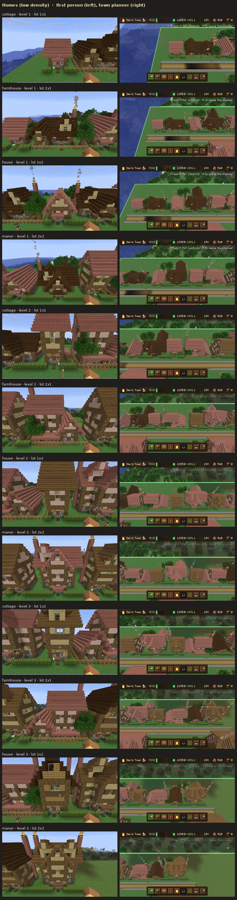
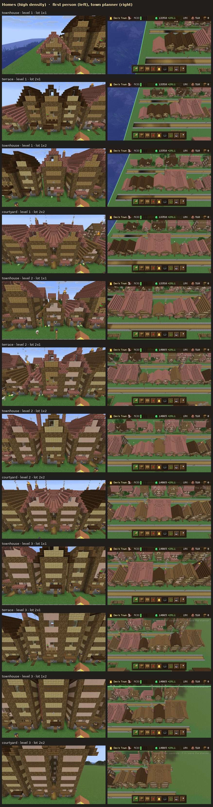
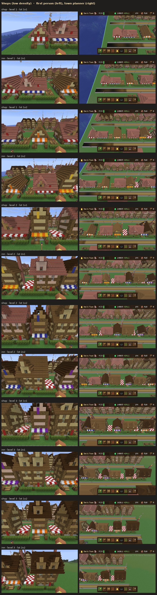
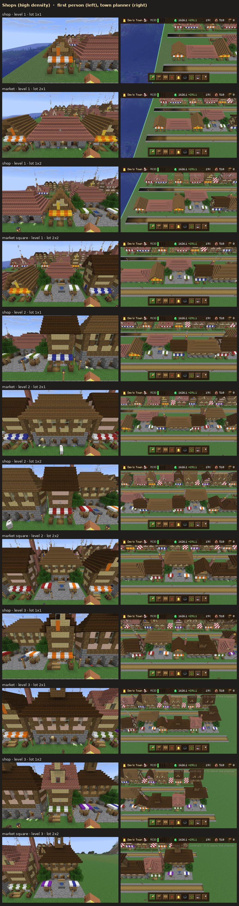
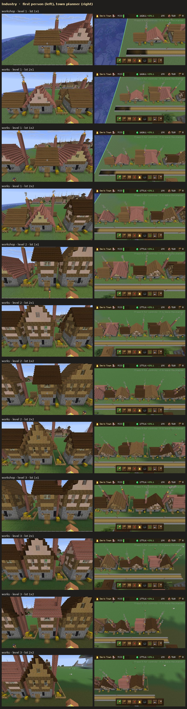
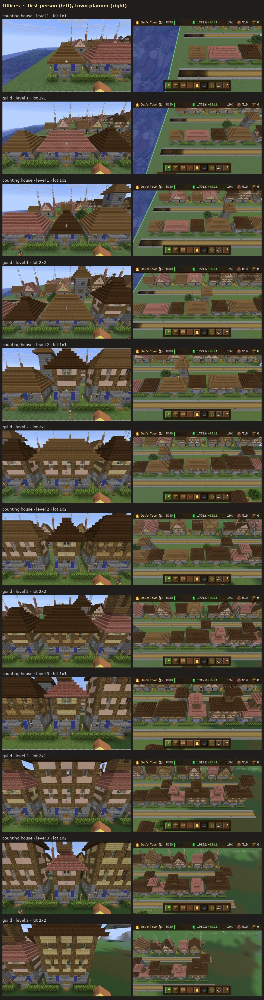
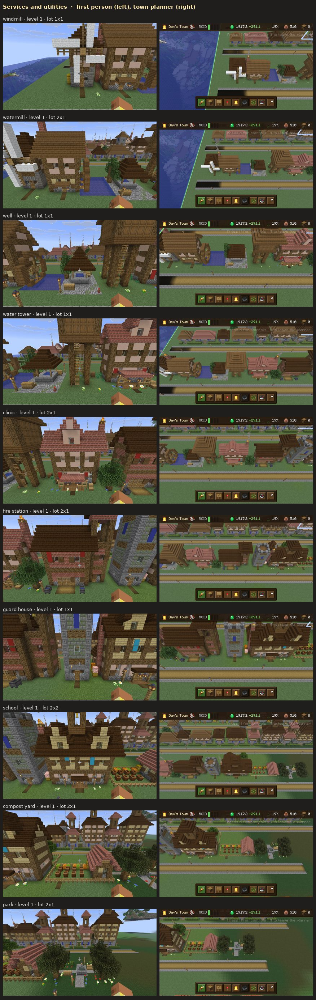
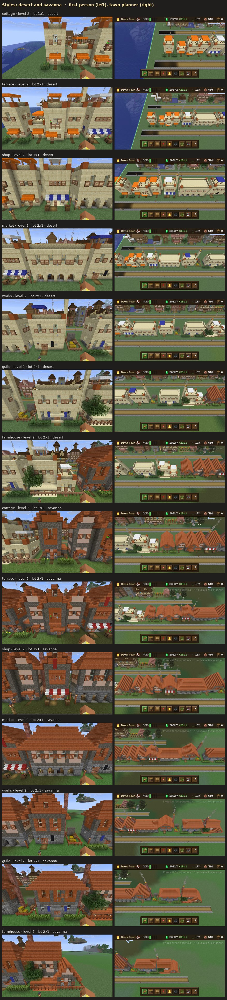
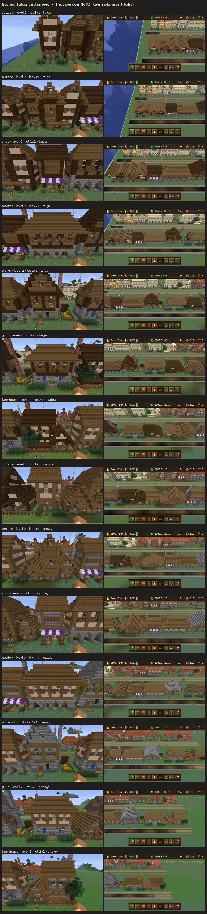

# Building gallery

Every building type in every variation, built by the real construction loop on test streets:
each growable zone at every lot shape (1x1, 2x1, 1x2, 2x2) and level (1-3), every service and utility, and each zone in
the desert, savanna, taiga and snowy styles. Each building is shown first person from the street and from the town
planner above (status icons hidden with V). Individual full-size shots are in `shots/`, named
`<row>_<index>_<kind>_L<level>_<lot>_<style>_fp|top.jpg`; `row<n>_overview_top.jpg` shows each whole street.

The test streets put buildings of all kinds side by side, so neighbours show at the edges of each shot.

## Homes (low density): cottage, farmhouse, house, manor

## Homes (high density): townhouse, terrace, courtyard

## Shops (low density): shop, inn

## Shops (high density): market hall, market square

## Industry: workshop, works

## Offices: counting house, guild hall

## Services and utilities

## Styles: desert and savanna

## Styles: taiga and snowy

